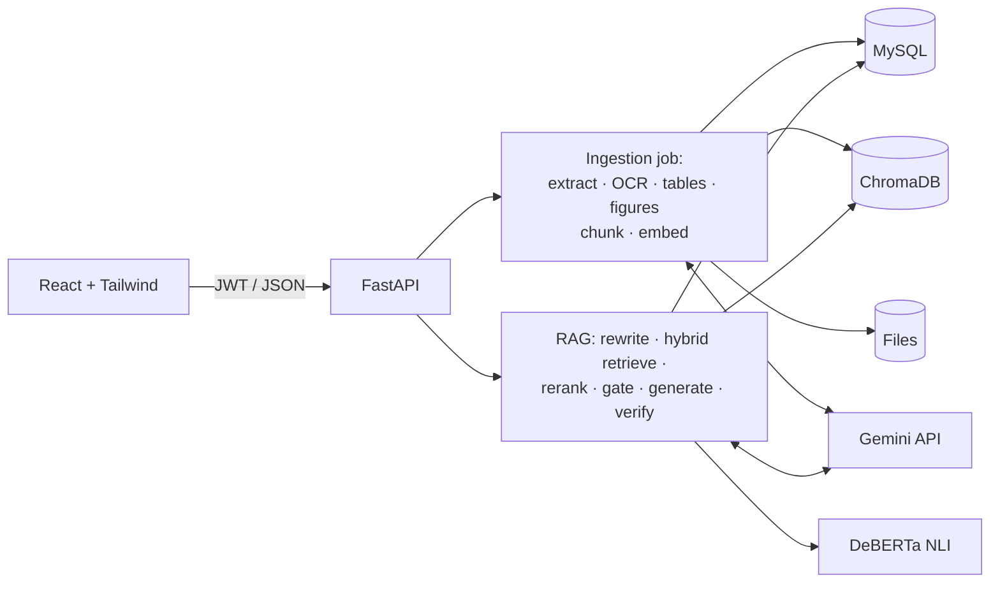

# DocuMind AI

**A multimodal, multilingual and hallucination-aware research assistant.**
Upload PDFs — research papers, textbooks, scanned notes — and ask questions in **English or Telugu**. DocuMind answers
only from your documents, cites the exact page for every statement, checks each statement against the evidence with a
separate verification model, and says *"I don't have enough information"* instead of guessing.


---

## What makes it different

| Capability | How |
|---|---|
| **Evidence-based answers** | Retrieval-Augmented Generation: hybrid search (multilingual embeddings + BM25, fused with Reciprocal Rank Fusion) → cross-encoder reranking → Gemini answers as a list of claims, each citing its sources |
| **Hallucination detection** | Every claim is checked against its cited passages with a DeBERTa-v3 NLI model → *supported / partly supported / not supported / contradicted*, with evidence and confidence |
| **Honest refusals** | A relevance gate refuses when no passage is relevant (no LLM call), and the model must report insufficient information |
| **English ↔ Telugu** | Cross-lingual retrieval with multilingual-E5; English pivot for keyword search, reranking and verification; answers in the user's chosen language |
| **Multimodal documents** | Two-column reading order, header/footer removal, OCR (OpenCV + Tesseract) for scanned pages, tables → Markdown, charts and images described by Gemini vision and attached to answers |
| **Measured, not claimed** | A reproducible benchmark (EN + TE questions with gold pages, labelled claims) comparing models, chunking, retrieval modes, the relevance gate and the hallucination detector |
| **Production practices** | JWT + rotating httpOnly refresh tokens, Argon2, per-user isolation, rate limiting, malicious-PDF screening, prompt-injection fencing, Alembic migrations, Docker Compose |

## Results (from `evaluation/`)

| Experiment | Result |
|---|---|
| Telugu question → English document, dense retrieval MRR | English-only MiniLM **0.27** · multilingual-E5-small **0.85** · multilingual-E5-base **0.80** |
| Hybrid + cross-encoder reranking, MRR | English **1.00** · Telugu (translated pivot) **1.00** · Telugu without translation **0.37** |
| Relevance gate at threshold 0.05 | **100%** of answerable questions answered, **100%** of unanswerable refused |
| Hallucination detector (31 labelled claims) | precision **0.94**, recall **1.00**, F1 **0.97** |

Small synthetic benchmark (5 documents, 15 pages, 41 questions × 2 languages) — use it to compare configurations, not as
an absolute quality claim. Methodology and limitations: [evaluation/README.md](evaluation/README.md) ·
[docs/modules/module-09-evaluation.md](docs/modules/module-09-evaluation.md).

## Architecture


Details, sequence diagrams and the data model: [docs/architecture.md](docs/architecture.md).

## Tech stack

| Layer | Technology |
|---|---|
| Frontend | React 19, Vite 8, Tailwind CSS 4, React Router, Axios, Vitest |
| Backend | Python 3.11, FastAPI, Pydantic v2, SQLAlchemy 2, Alembic, PyJWT, pwdlib (Argon2) |
| Database | MySQL (8.4 LTS / 9.x), utf8mb4 |
| Documents | PyMuPDF, pdfplumber, Tesseract OCR, OpenCV |
| AI/ML | PyTorch (CPU), Hugging Face Transformers, sentence-transformers, multilingual-E5, MiniLM cross-encoder, DeBERTa-v3 NLI, LlamaIndex (sentence splitter), Google Gemini (text + vision) |
| Retrieval | ChromaDB (HNSW, cosine), rank-bm25, Reciprocal Rank Fusion |
| Evaluation | Custom Precision@K / Recall@K / MRR, RAGAS-style faithfulness & relevance, matplotlib |
| Deployment | Docker, Docker Compose, nginx; AWS mapping in docs |

## Quick start (Windows, local)

Prerequisites: Python 3.11, Node.js 20+, MySQL 8.4+/9.x. Optional: Tesseract OCR (scanned PDFs), a free
[Gemini API key](https://aistudio.google.com/apikey) (answers, Telugu translation, figure descriptions).

```sql
-- MySQL, once
CREATE DATABASE documind CHARACTER SET utf8mb4 COLLATE utf8mb4_0900_ai_ci;
CREATE USER 'documind_user'@'localhost' IDENTIFIED BY 'your-password';
GRANT ALL PRIVILEGES ON documind.* TO 'documind_user'@'localhost';
```

```powershell
# Backend (terminal 1)
cd backend
py -3.11 -m venv .venv
.\.venv\Scripts\Activate.ps1
pip install -r requirements.txt          # includes PyTorch CPU, ~1.5 GB
Copy-Item .env.example .env              # set MYSQL_PASSWORD, JWT_SECRET_KEY, GEMINI_API_KEY
alembic upgrade head
uvicorn app.main:app --reload            # first start downloads ~2 GB of models in the background

# Frontend (terminal 2)
cd frontend
npm install
Copy-Item .env.example .env
npm run dev                              # http://localhost:5173
```
API docs: http://localhost:8000/docs

### With Docker
```powershell
Copy-Item .env.docker.example .env       # set passwords, JWT secret, optional Gemini key
docker compose up --build                # http://localhost:8080
```
See [docs/deployment.md](docs/deployment.md) (includes AWS options).

## Tests and evaluation

```powershell
cd backend;  pytest -q            # ~100 tests: unit, API, integration, security (fake models, offline)
cd frontend; npm test             # frontend unit tests

# Benchmark with the real models (from the repository root)
backend\.venv\Scripts\python evaluation\build_corpus.py
backend\.venv\Scripts\python evaluation\run_retrieval_eval.py
backend\.venv\Scripts\python evaluation\run_verifier_eval.py
backend\.venv\Scripts\python evaluation\run_generation_eval.py --limit 20   # needs GEMINI_API_KEY
```

## Project structure

```
DocuMind-AI/
├── backend/            FastAPI app (api, core, db, models, schemas, services), Alembic migrations, tests
├── frontend/           React app (pages, components, contexts, api client), nginx config
├── evaluation/         corpus, EN/TE questions, labelled claims, experiment runners, results
├── docs/               architecture, API, deployment, demo guide, per-module learning guides
└── docker-compose.yml
```

## Documentation

| Document | Contents |
|---|---|
| [docs/architecture.md](docs/architecture.md) | System, ingestion and question-answering diagrams; data model; scaling notes |
| [docs/api.md](docs/api.md) | Every endpoint with examples |
| [docs/deployment.md](docs/deployment.md) | Docker Compose, AWS, production checklist |
| [docs/demo-guide.md](docs/demo-guide.md) | 10-minute demo script |
| [docs/modules/](docs/modules/) | 12 learning guides: concepts, steps, errors, interview questions |
| [evaluation/README.md](evaluation/README.md) | Benchmark methodology and limitations |

## Security highlights
Argon2id password hashing · 15-min JWT access tokens in memory + rotating httpOnly refresh cookie with reuse detection ·
per-user isolation in SQL and vector filters (404 for others' data) · rate limits on login, sign-up, questions, uploads ·
PDF signature, size, duplicate and active-content checks (JavaScript, launch actions, embedded files) · prompt-injection
fencing and flagging · security headers, generic error responses with request ids · secrets only in environment files,
with a test that fails if a key is committed. Details: [docs/modules/module-11-testing-security.md](docs/modules/module-11-testing-security.md).

## Limitations
- Verification is a strong signal, **not proof**: NLI misses comparisons across table rows and arithmetic.
- Telugu answers are machine-translated; verification runs on the English claims.
- CPU-only inference: the first questions are slow while models load; reranking adds seconds per question.
- The benchmark is small and synthetic; Telugu questions need native-speaker review.
- Single-process background jobs and rate limits (Redis/Celery needed for multiple servers).
- The Docker setup has not yet been built on the development machine.

## Author
Narla Rashmika — Computer Science Engineering student (2027).
