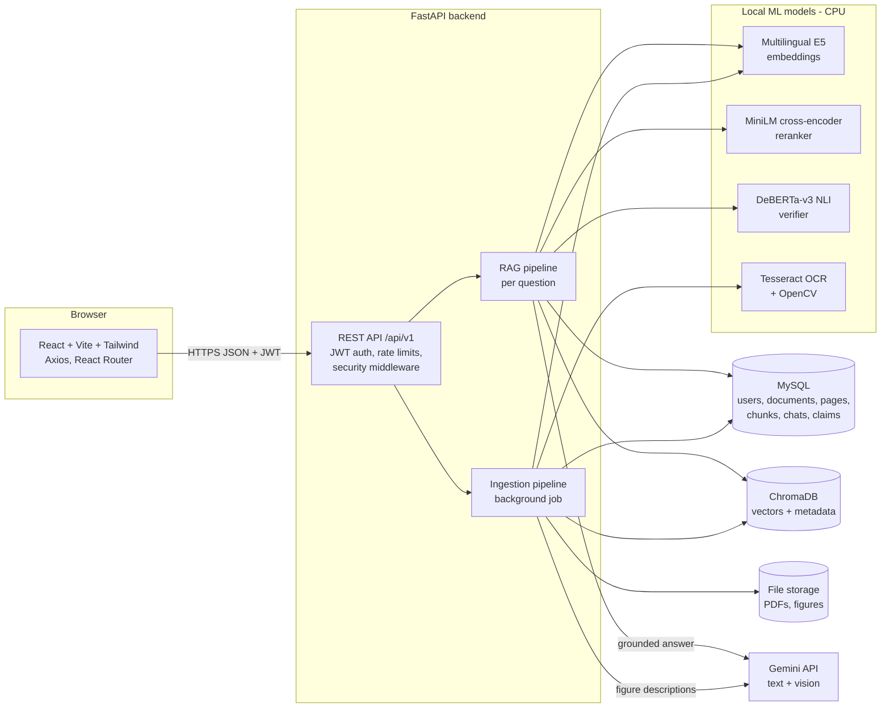
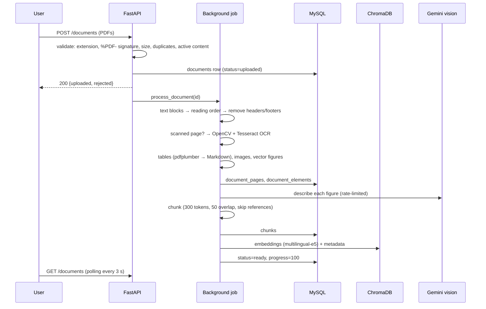
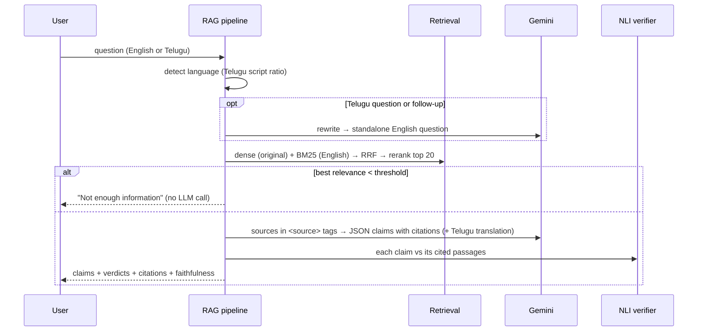

# Architecture

## System overview



**Design principles**

- **MySQL is the source of truth; ChromaDB is an index.** Chunk text lives in MySQL, so the vector index can be rebuilt, BM25 can run over the same chunks, and citations show exact passages.
- **Isolation on the server.** Every query filters by `user_id` (SQL and vector metadata). Other users' resources return 404.
- **English pivot for Telugu.** Dense retrieval is cross-lingual; BM25, reranking and NLI verification run on English; Telugu is used at the edges.
- **Answers are lists of cited claims**, which makes every sentence verifiable.
- **Expensive work is done once:** figures are described at upload, models load once per process.

## Ingestion pipeline (after upload)



## Question answering



## Data model

```mermaid
erDiagram
    users ||--o{ refresh_tokens : has
    users ||--o{ documents : owns
    users ||--o{ conversations : has
    documents ||--o{ document_pages : contains
    documents ||--o{ document_elements : contains
    documents ||--o{ chunks : "split into"
    document_elements |o--o{ chunks : "described by"
    conversations ||--o{ messages : contains
    messages ||--o{ citations : cites
    messages ||--o{ claims : "made of"
    chunks |o--o{ citations : "source of"

    users { int id PK; string email UK; string hashed_password; string preferred_language }
    documents { int id PK; int user_id FK; string stored_filename UK; string sha256; string status; int progress; string embedding_model }
    document_pages { int id PK; int document_id FK; int page_number; mediumtext text; string extraction_method }
    document_elements { int id PK; int document_id FK; int page_number; string element_type; mediumtext content; string image_path }
    chunks { int id PK; int document_id FK; int page_number; string element_type; mediumtext text; int token_count }
    conversations { int id PK; int user_id FK; string title; json document_ids }
    messages { int id PK; int conversation_id FK; string role; mediumtext content; string status; float faithfulness_score; json details }
    citations { int id PK; int message_id FK; int number; int chunk_id FK; string document_title; int page_number; text snippet }
    claims { int id PK; int message_id FK; text text; json cited_numbers; string verdict; float confidence }
```

All foreign keys from children to `users`/`documents`/`conversations`/`messages` use `ON DELETE CASCADE`. `citations.chunk_id` and `citations.document_id` use `SET NULL`, so old answers keep their copied snippets after a document is deleted.

## Backend layout

```
backend/app/
├── main.py                 app, CORS, middleware, startup (job recovery, model preload)
├── core/                   config, security (JWT, Argon2), rate limiting, middleware, clock
├── db/                     engine/session, declarative base, MEDIUMTEXT type
├── models/                 SQLAlchemy ORM models
├── schemas/                Pydantic request/response models
├── api/v1/                 router, dependencies (CurrentUser, rate-limit deps), cookies, routes/*
└── services/
    ├── processing/         text layout, OCR, tables, images, extractor, pipeline
    ├── chunking/           chunk strategies
    ├── embeddings/         model registry and encoder
    ├── vectorstore/        ChromaDB wrapper
    ├── retrieval/          dense, BM25, RRF + reranking orchestration
    ├── llm/                Gemini client, prompts and output schemas
    ├── rag/                question-answering pipeline
    ├── multilingual/       language detection
    ├── multimodal/         figure description and figure images for answers
    ├── verification/       NLI model and claim verifier
    ├── security/           upload validation, prompt-injection guard
    ├── indexing.py, document_service.py, auth_service.py, chat_service.py
```

## Scaling notes (beyond this project)

| Concern | Current | At scale |
|---|---|---|
| Background jobs | FastAPI BackgroundTasks, one at a time per process | Celery/RQ workers + Redis queue, separate worker containers (GPU optional) |
| Rate-limit counters | in-process memory | Redis |
| Files | local volume | S3 / object storage with presigned URLs |
| Vectors | embedded ChromaDB | Chroma server, pgvector, Qdrant or OpenSearch |
| Models | loaded in the API process | dedicated inference service (e.g. TEI) shared by workers |
| LLM | Gemini free tier | paid tier / provider fallback, response caching |
