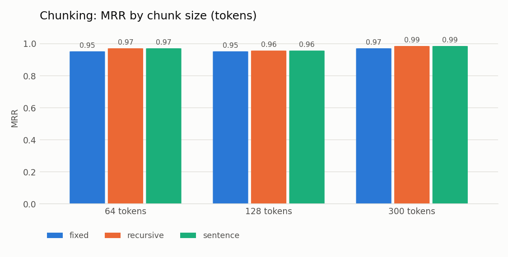
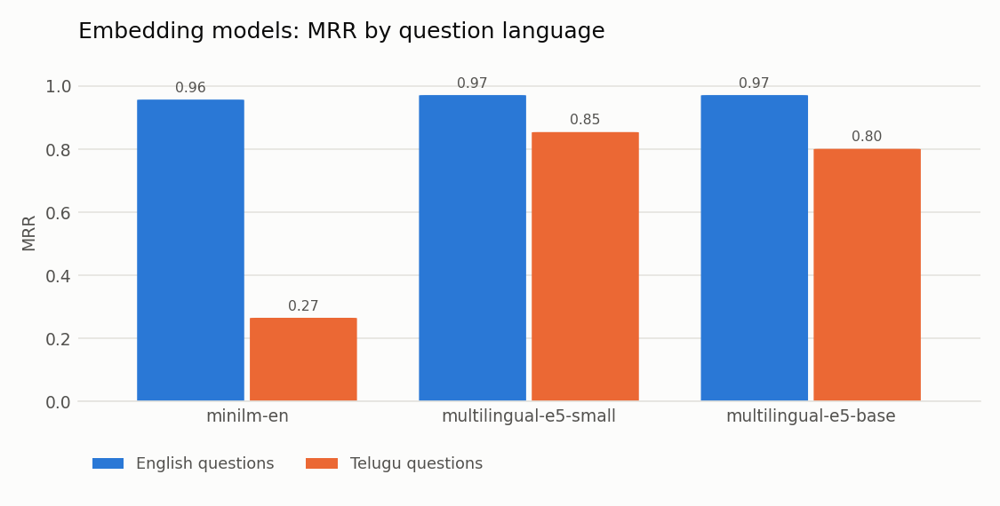
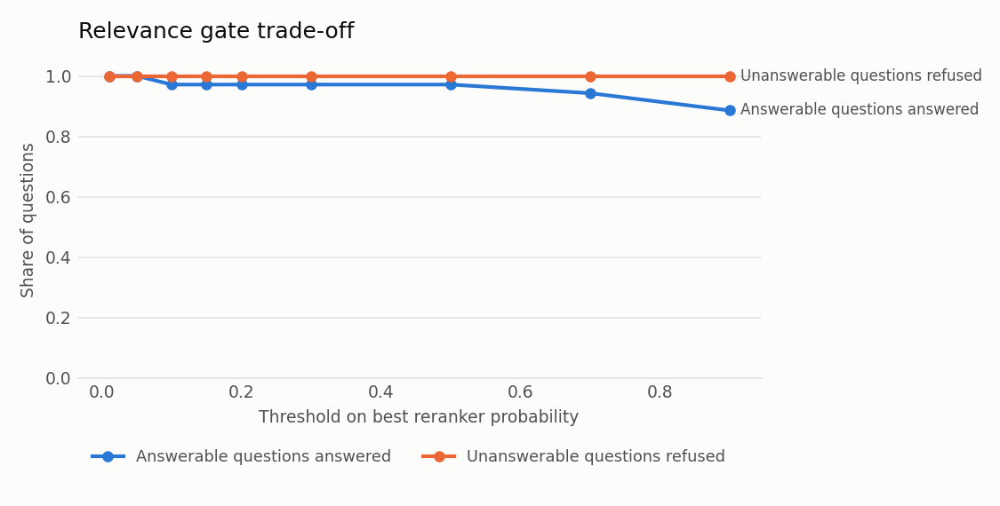
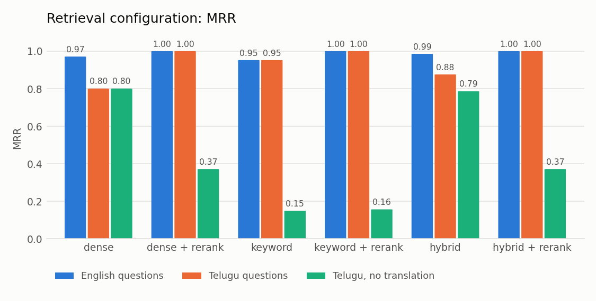

# Retrieval evaluation – retrieval_2026-11-22T10-32-33

Dataset: 35 answerable questions over 5 documents (15 pages). Relevance is judged by gold page.

## Embedding models (dense retrieval)

| model | language | mrr | precision@1 | precision@3 | recall@3 | recall@5 | hit@5 | latency_ms_mean |
|---|---|---|---|---|---|---|---|---|
| minilm-en | en | 0.957 | 0.914 | 0.505 | 1.000 | 1.000 | 1.000 | 69.800 |
| minilm-en | te | 0.265 | 0.114 | 0.105 | 0.271 | 0.443 | 0.486 | 57.100 |
| multilingual-e5-small | en | 0.971 | 0.943 | 0.486 | 1.000 | 1.000 | 1.000 | 100.500 |
| multilingual-e5-small | te | 0.854 | 0.771 | 0.457 | 0.914 | 0.971 | 0.971 | 109.400 |
| multilingual-e5-base | en | 0.971 | 0.943 | 0.476 | 1.000 | 1.000 | 1.000 | 161.600 |
| multilingual-e5-base | te | 0.801 | 0.686 | 0.448 | 0.943 | 0.971 | 0.971 | 195.600 |

## Chunking strategies and sizes (hybrid, English)

| strategy | chunk_size | chunks | mrr | precision@1 | precision@3 | recall@3 | recall@5 | hit@5 | latency_ms_mean |
|---|---|---|---|---|---|---|---|---|---|
| fixed | 64 | 86 | 0.952 | 0.914 | 0.752 | 1.000 | 1.000 | 1.000 | 153.400 |
| fixed | 128 | 40 | 0.952 | 0.914 | 0.676 | 1.000 | 1.000 | 1.000 | 166.500 |
| fixed | 300 | 21 | 0.971 | 0.943 | 0.495 | 1.000 | 1.000 | 1.000 | 165.000 |
| recursive | 64 | 89 | 0.971 | 0.943 | 0.724 | 1.000 | 1.000 | 1.000 | 167.700 |
| recursive | 128 | 41 | 0.957 | 0.914 | 0.648 | 1.000 | 1.000 | 1.000 | 172.200 |
| recursive | 300 | 21 | 0.986 | 0.971 | 0.476 | 1.000 | 1.000 | 1.000 | 162.500 |
| sentence | 64 | 89 | 0.971 | 0.943 | 0.724 | 1.000 | 1.000 | 1.000 | 189.600 |
| sentence | 128 | 41 | 0.957 | 0.914 | 0.648 | 1.000 | 1.000 | 1.000 | 173.600 |
| sentence | 300 | 21 | 0.986 | 0.971 | 0.476 | 1.000 | 1.000 | 1.000 | 171.900 |

## Retrieval modes and reranking

| mode | rerank | language | mrr | precision@1 | precision@3 | recall@3 | recall@5 | hit@5 | latency_ms_mean |
|---|---|---|---|---|---|---|---|---|---|
| dense | False | en | 0.971 | 0.943 | 0.476 | 1.000 | 1.000 | 1.000 | 168.500 |
| dense | False | te | 0.801 | 0.686 | 0.448 | 0.943 | 0.971 | 0.971 | 213.200 |
| dense | False | te_raw | 0.801 | 0.686 | 0.448 | 0.943 | 0.971 | 0.971 | 248.300 |
| dense | True | en | 1.000 | 1.000 | 0.476 | 1.000 | 1.000 | 1.000 | 2064.100 |
| dense | True | te | 1.000 | 1.000 | 0.476 | 1.000 | 1.000 | 1.000 | 1532.900 |
| dense | True | te_raw | 0.372 | 0.257 | 0.171 | 0.329 | 0.457 | 0.486 | 2336.100 |
| keyword | False | en | 0.952 | 0.914 | 0.467 | 1.000 | 1.000 | 1.000 | 0.900 |
| keyword | False | te | 0.952 | 0.914 | 0.467 | 1.000 | 1.000 | 1.000 | 0.600 |
| keyword | False | te_raw | 0.150 | 0.143 | 0.095 | 0.143 | 0.171 | 0.171 | 1.000 |
| keyword | True | en | 1.000 | 1.000 | 0.486 | 1.000 | 1.000 | 1.000 | 626.400 |
| keyword | True | te | 1.000 | 1.000 | 0.486 | 1.000 | 1.000 | 1.000 | 743.500 |
| keyword | True | te_raw | 0.157 | 0.143 | 0.105 | 0.171 | 0.171 | 0.171 | 32.900 |
| hybrid | False | en | 0.986 | 0.971 | 0.476 | 1.000 | 1.000 | 1.000 | 107.200 |
| hybrid | False | te | 0.876 | 0.771 | 0.467 | 1.000 | 1.000 | 1.000 | 106.300 |
| hybrid | False | te_raw | 0.787 | 0.657 | 0.448 | 0.943 | 0.971 | 0.971 | 257.300 |
| hybrid | True | en | 1.000 | 1.000 | 0.476 | 1.000 | 1.000 | 1.000 | 2479.200 |
| hybrid | True | te | 1.000 | 1.000 | 0.476 | 1.000 | 1.000 | 1.000 | 2973.300 |
| hybrid | True | te_raw | 0.372 | 0.257 | 0.171 | 0.329 | 0.457 | 0.486 | 2480.800 |

## Relevance gate (refuse when best reranker score < threshold)

| threshold | answerable_answered | unanswerable_refused |
|---|---|---|
| 0.010 | 1.000 | 1.000 |
| 0.050 | 1.000 | 1.000 |
| 0.100 | 0.971 | 1.000 |
| 0.150 | 0.971 | 1.000 |
| 0.200 | 0.971 | 1.000 |
| 0.300 | 0.971 | 1.000 |
| 0.500 | 0.971 | 1.000 |
| 0.700 | 0.943 | 1.000 |
| 0.900 | 0.886 | 1.000 |

## Charts

